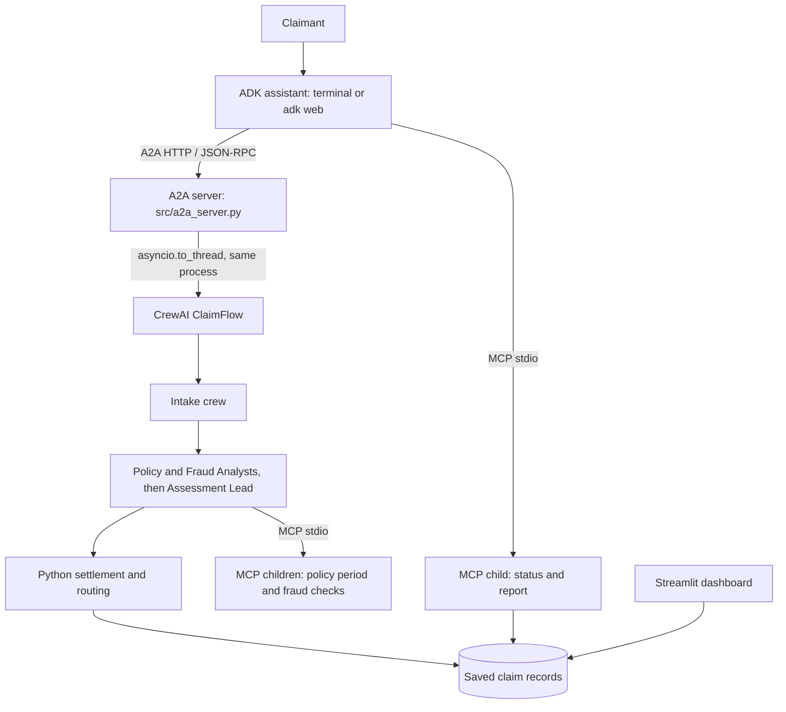

# Architecture and reading order

ClaimSight separates conversation, adjudication and display. Agent roles are
Python objects inside their host processes, not individually deployed services.

## Processes and boundaries

Local services use the same `data/` directories. The recorded cloud deployment
mounts shared Cloud Storage paths so separate containers can see completed
records. Monitoring writes locally during a run and archives its finished log
through `CLAIMSIGHT_LOG_ARCHIVE`.

## Entry points

| File | Purpose | Execution boundary |
|---|---|---|
| `run_flow.py` | Direct adjudication, plot, explicit resume | Calls `ClaimFlow.kickoff`; bypasses ADK/A2A |
| `run_assistant.py` | Terminal ADK conversation | Session + Runner; remote adjudication through A2A |
| `src/a2a_server.py` | Agent card and JSON-RPC requests | Runs the Flow on a worker thread inside the server |
| `dashboard/app.py` | Saved results and evidence demonstration | Local live mode spawns `run_flow.py`; hosted mode refuses it |
| `run_intake.py`, `run_assessment.py`, `run_damage_analyst.py` | Inspect individual pipeline stages | Diagnostic runs can call models |
| `add_evidence.py` | Validate evidence and optionally resume | Evidence acceptance is deterministic; reassessment can call models |
| `show_report.py`, `show_log.py` | Read recorded explanations/activity | No new model judgement |

Cloud assistant startup is `adk web ... agents`, using the same agent package as
the terminal runner. It does not execute `run_assistant.py`.

## Read the implementation in this order

1. **State and orchestration:** `src/claim_flow.py` — `ClaimState`, `ClaimFlow`,
   completeness, date enforcement, routers and `run_or_resume`.
2. **Data contracts:** `src/models.py` — invoices, photo findings, intake,
   assessment decisions and reports.
3. **Agents:** `src/crews/intake_crew.py` and `src/crews/assessment_crew.py`.
   Intake has Document Reader + Intake Officer and an optional Damage Analyst.
   Assessment has Policy Analyst + Fraud Analyst running asynchronously, then
   Assessment Lead joining both reports.
4. **Deterministic functions:** `src/tools/` — period, prices, prior claims,
   photo comparisons and settlement arithmetic.
5. **Framework boundaries:** `src/mcp_server.py`, `claimsight_tools`,
   `agents/claimant_assistant/agent.py`, then `src/a2a_server.py`.
6. **Safety:** `src/guardrails.py`, `src/citations.py`, `src/clause_scope.py`,
   `src/vision.py` and `src/evidence.py`.
7. **Evidence and visibility:** `src/monitoring.py`, `src/observability.py`,
   `src/reporting.py`, then `dashboard/data_adapter.py`.
8. **Measurement:** `evaluation/evaluate_phase2.py`, its saved run notes, and
   [changes since evaluation](CHANGES_SINCE_EVAL.md).

## Important design distinctions

- **A2A delegates an entire assessment; MCP exposes individual tools.** Each
  framework starts its own MCP subprocesses from the same server implementation.
- **Models recommend; Python controls money and routes.** The Lead selects
  invoice lines; deterministic code computes payable amounts. Period checks are
  also enforced after the crew, independently of the model's interpretation.
- **Missing evidence is not rejection.** A claim can wait, accept validated
  evidence and resume without rerunning unaffected stages.
- **Assessment guardrail exhaustion is not an infrastructure outage.** Exhausted
  validation is escalated; transport failures continue to fail for later retry.
- **Not visible is not undamaged.** A photo raises a fraud signal only when a
  billed part is positively seen intact; unseen parts need more evidence.
- **Conversation, A2A task and claim state differ.** Terminal sessions and A2A
  tasks use in-memory stores, while completed claim state is saved separately.
- **Tracing is not one distributed trace.** ADK and CrewAI execute in separate
  processes, with no propagated A2A trace context. Concurrent analyst-thread tool
  calls may go unlogged when request ownership cannot be resolved safely.

The [code map](CODE_MAP.md) maps requirements to current files and symbols.
Its earlier line-by-line version is retained in the documentation archive. Known positive-coverage citation
gaps and evaluation drift are documented, not evidence of full correctness.
